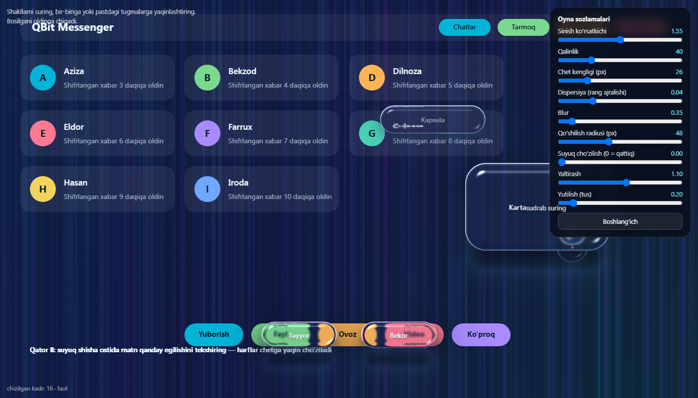
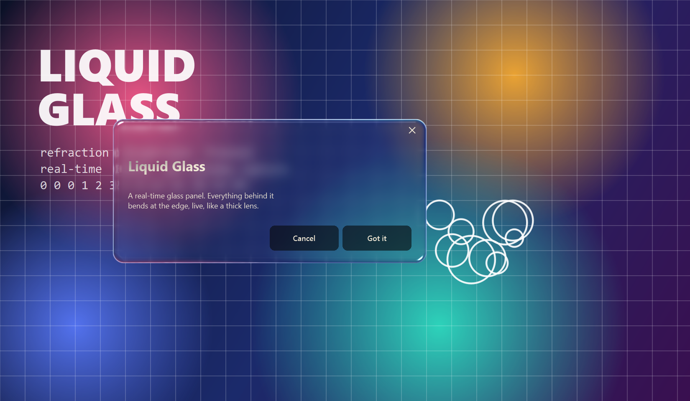
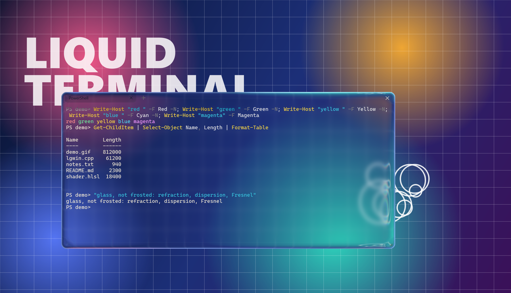
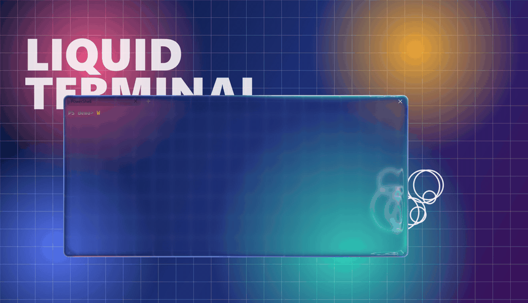

<div align="center">



# liquidglass

**Real liquid glass, computed instead of faked.**<br>
Refraction, dispersion, Fresnel and frost in real time, for the web, Qt and native Windows.

[Live demo](https://dilmurod3037729-max.github.io/liquidglass/web/demo/) ·
[Water demo](https://dilmurod3037729-max.github.io/liquidglass/web/demo/water.html) ·
[Quick start](#quick-start) ·
[Platforms](#platforms) ·
[Changelog](CHANGELOG.md)

[](https://github.com/dilmurod3037729-max/liquidglass/actions/workflows/ci.yml)
[](https://www.npmjs.com/package/@dilmurod3037729/liquidglass-web)
[](LICENSE)
[](https://github.com/dilmurod3037729-max/liquidglass/stargazers)

</div>

## Why liquidglass

CSS `backdrop-filter` can blur what is behind an element, but it cannot bend it. liquidglass traces how light passes through a
thick glass surface, so the edges act like a real lens and shapes can merge like liquid.

| | CSS blur | liquidglass |
|---|---|---|
| Blur and frost | yes | yes |
| Edge refraction (a lens) | no | yes |
| Chromatic dispersion | no | yes |
| Fresnel reflection and total internal reflection | no | yes |
| Shapes merging like liquid | no | yes |
| Depth by focus | no | yes |
| Bends other applications on the desktop (Windows) | no | yes |

## Quick start

**Web** (no dependencies, WebGL2)

```bash
npm install @dilmurod3037729/liquidglass-web
```

```js
import { createLiquidGlass } from '@dilmurod3037729/liquidglass-web';

const glass = createLiquidGlass(canvas, { mode: 'glass', source: sceneCanvas });
glass.add({ w: 220, h: 58, radius: 29 }, { x: 300, y: 200 }, labelElement);
glass.params.bevel = 18;
```

WebGL cannot read the page DOM, so the glass refracts a `source` (canvas, image or video) that you provide.
Run the demo locally with `node web/scripts/serve.mjs` and open `http://localhost:5173/demo/`. More in [`web/README.md`](web/README.md).

**Python / Qt on Windows**: turns the real buttons of an existing PySide6 app into glass without touching its code
(see [`python/README.md`](python/README.md)). Download `lgwin.dll` from the [latest release](https://github.com/dilmurod3037729-max/liquidglass/releases/latest) into `win-native/`, or build it (needs Visual Studio with the C++ workload):

```
win-native\build_dll.bat
python python\popup_demo.py
```

## Platforms

| Target | Graphics API | Folder | Status |
|---|---|---|---|
| Browsers with WebGL2, Electron | WebGL2 | [`web/`](web/) | Stable, on npm |
| C++17 core with OpenGL 3.3 and Qt 6 backends | OpenGL | [`core/`](core/) | Stable, golden-tested against the JS port |
| Windows 11, any window or popup | Direct3D 11 | [`win-native/`](win-native/) | Works, DLL on the releases page |
| PySide6 apps | Direct3D 11 / OpenGL | [`python/`](python/) | Works, run from source |
| Windows 10 | | | Untested, may show the yellow capture border |

## Native Windows backend




A real-time glass panel for any Qt window on Windows: everything behind it, including other applications, bends at the edge like a
thick lens, with dispersion, frost and a rim highlight. The picture is a synthetic scene; in the GIF the background stays perfectly
still while the glass moves over it.

- **Per-window backdrop.** Each window under the popup is captured separately with Windows.Graphics.Capture, so the glass never sees
  itself (no feedback loop, no stale or frozen backdrop). No administrator rights and no injection.
- **Fixed overlay.** The overlay window never moves; the glass is drawn inside its swap chain. Moving a window and updating its image
  used to land on different frames, so the backdrop jumped while dragging. Measured with a screen-capture test (a hue ramp behind a
  popup dragged at about 2000 px/s): 9-14 of 34 frames were visibly wrong before, 0 in three runs after.
- **Cheap when idle.** Only changes under the popup trigger a redraw (WGC dirty regions). One popup, idle, on one Windows 11 machine
  with an NVIDIA GPU: about 3.5 % of one CPU core, the popup's own GPU use under 1 %.
- **Throttled when busy.** Redraws caused by a changing backdrop are rate-limited per window, so several glass windows over a
  60 Hz backdrop do not saturate the GPU.

### Built with it: a glass terminal





A small terminal (PySide6, ConPTY) whose whole window is glass. The text is drawn by the app and sits on top of the glass, its
colour adapts to what is behind it, and the glass refracts whatever lies under it, including other glass windows. The terminal is a
proof that the backend is usable for real work; its source is not part of this repository.

## Limitations, honestly

- Native backend: Windows only. Tested on Windows 11 only. Protected windows (DRM video) are not visible behind the glass, window
  shadows are not part of the backdrop, and each popup has a full-desktop transparent overlay, so several popups cost proportionally
  more. A hardware Direct3D 11 GPU is required.
- Web: the glass refracts a `source` you provide, not the live DOM.
- The Windows DLL is not code-signed (Windows SmartScreen may warn). Prebuilt binaries are attached to each [release](https://github.com/dilmurod3037729-max/liquidglass/releases); you can also build from source.

## Repository layout

| Folder | What |
|---|---|
| [`web/`](web/) | Dependency-free WebGL2 library (ES modules), demos, Electron host, tests |
| [`core/`](core/) | C++17 core: shapes, physics, shader source of truth. OpenGL 3.3 demo and Qt 6 backend |
| [`win-native/`](win-native/) | Windows DLL (Direct3D 11, Windows Graphics Capture), C# binding |
| [`python/`](python/) | PySide6 integration and demos |

Tests: `cd web && npm test` (the JS core matches the C++ core; the water simulation stays stable at extreme settings).

## Contributing

See [CONTRIBUTING.md](CONTRIBUTING.md). Questions and show-and-tell go to [Discussions](https://github.com/dilmurod3037729-max/liquidglass/discussions).
Security reports: [SECURITY.md](SECURITY.md).

## License

MIT, see [LICENSE](LICENSE). Not affiliated with or endorsed by Apple.
