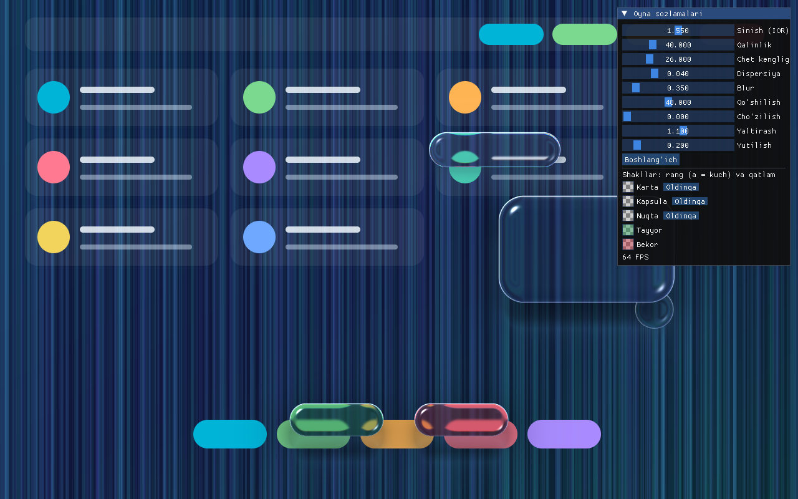
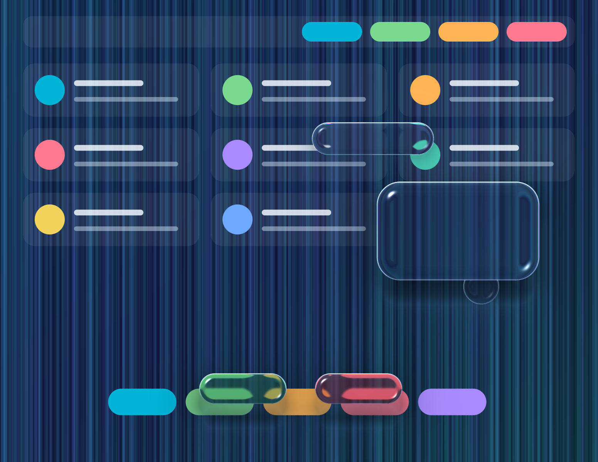

# liquidglass (core)

The core of the physically based "liquid glass" library. It does not depend on any graphics API.

- `include/liquidglass/`: `Scene` (shapes, spring, focus/layers, uniform packing) and SDF helpers
- `shaders/liquidglass.frag`: the single shader source (GLSL ES 3.0): refraction, dispersion, Fresnel, total internal reflection, absorption, shadow/caustic
- `tests/`: core tests (spring, focus, merging, independence from the frame rate)

## Two-pass rendering

1. **Back pass:** the scene texture plus the shapes behind -> FBO (`PassUniforms` = `Scene::pack(Pass::Back)`, `uFlip=0`)
2. **Front pass:** the FBO plus the front shapes -> screen (`Pass::Front`, `uFlip=1`). The front glass refracts the one behind it.

Every frame the backend calls `scene.step(dt)`: if it returns `true`, draw; if `false`, skip the frame.

## Build

    cmake -S . -B build -G "Visual Studio 17 2022" -A x64
    cmake --build build --config Release
    ctest --test-dir build -C Release

(On Linux and macOS: `cmake -S . -B build && cmake --build build && ctest --test-dir build`.)

## Native backend (OpenGL 3.3 + GLFW + Dear ImGui)

`native/` holds an OpenGL renderer (`GlRenderer`) that runs the same shader as the web version on top of the `lg::Scene` core, and a sample app.
On the first build GLFW and ImGui are downloaded from GitHub automatically (internet required).

    cmake -S . -B build-native -G "Visual Studio 17 2022" -A x64 -DLG_BUILD_NATIVE=ON
    cmake --build build-native --config Release --target native_demo
    build-native\native\Release\native_demo.exe              # interactive: drag shapes, tune in the panel
    build-native\native\Release\native_demo.exe --shot a.png # windowless screenshot (scripted drag)

To use the renderer in your own app: `lg::gl::load()` (after the GLFW context exists), `GlRenderer::init(fragPath)`, `resize()`,
`setSource(rgba, w, h)`, and every frame `scene.step(dt)` and `renderer.render(scene, dpr, light)`.
Limitation: the scene (the image that gets refracted) is supplied by you as RGBA pixels; OpenGL 3.3 core is required.

## Qt 6 backend (QOpenGLWidget)

`qt/` holds `GlassWidget` (a QOpenGLWidget): the same `GlRenderer`, shader and `lg::Scene` core. The sample app has a panel of Qt sliders.

    cmake -S . -B build-qt -G Ninja -DLG_BUILD_QT=ON -DCMAKE_PREFIX_PATH=<Qt>/6.x/<kit>
    cmake --build build-qt
    build-qt\qt\qt_demo.exe              # interactive
    build-qt\qt\qt_demo.exe --shot a.png # windowless screenshot (scripted drag)

To use it in your own Qt app: create a `GlassWidget`, add shapes through `scene()` (`add`, `setTint`), and give it the scene to refract with `setSource(QImage)`.
Tested kit: Qt 6.11 MinGW 13.1 (Windows). OpenGL 3.3 core is required.
