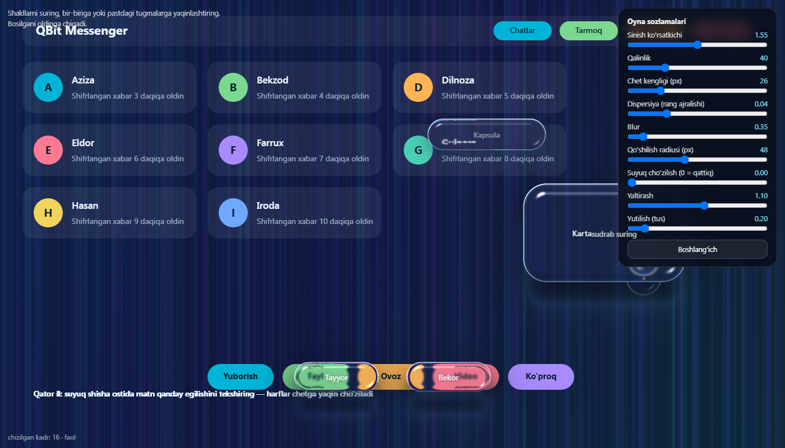
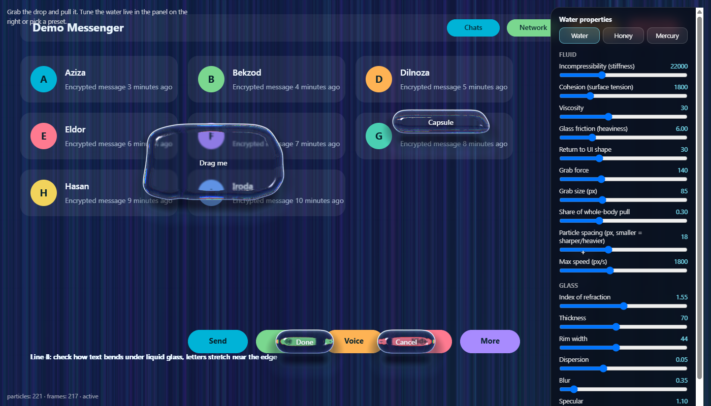

# liquidglass-web




Fizikaga asoslangan "suyuq shisha" (WebGL2), bog'liqliksiz ES modul. Ikki rejim:

- **`glass`** (asosiy): toza qattiq oyna. Markazi tiniq, sinish faqat ingichka chetda. Snell sinishi, dispersiya, Fresnel,
  to'liq ichki qaytish, yutilish, soya/kaustika, shakllarning suyuqdek **qo'shilishi** va fokusga qarab **chuqurlik**
  (orqadagi oynani oldingi shisha sindiradi).
- **`water`** (ixtiyoriy): zarrachali erkin suv. Yopishadi, siqilmaydi, oynada og'ir sirpanadi.

## Tez ulash (CDN, o'rnatishsiz)

```js
import { createLiquidGlass } from 'https://cdn.jsdelivr.net/gh/dilmurod3037729-max/liquidglass@main/web/src/index.js';
```

## Tez boshlash

    node scripts/serve.mjs      # http://localhost:5173/demo/        (qattiq oyna, jonli sozlash paneli bilan)
                                # http://localhost:5173/demo/water.html   (suv)

```js
import { createLiquidGlass } from './src/index.js';

const glass = createLiquidGlass(canvas, { mode: 'glass', source: sceneCanvas });   // canvas | img | video | ImageBitmap
glass.add({ w: 220, h: 58, radius: 29 }, { x: 300, y: 200 }, labelElement);
glass.add({ w: 150, h: 52, radius: 26, draggable: false }, { x: 500, y: 600 });   // qo'zg'almas panel/tugma
```

## Sozlash (qattiq oyna)

Hamma narsa `glass.params` orqali jonli o'zgaradi. Har sozlama `GLASS_SCHEMA` dagi oraliqqa qirqiladi.

| Sozlama | Nima qiladi | Standart |
|---|---|---|
| `ior` | sinish ko'rsatkichi (katta = kuchliroq egilish) | 1.55 |
| `thick` | shisha qalinligi (siljish kuchi) | 40 |
| `bevel` | chet kengligi, px. Jism yarmidan oshmaydi, markaz doim tiniq | 26 |
| `disp` | dispersiya: chetdagi rang ajralishi | 0.04 |
| `blur` | sochilish (xiralik) | 0.35 |
| `merge` | yaqin shakllar qo'shilish radiusi, px | 48 |
| `elastic` | suyuq cho'zilish. 0 = qattiq oyna, kattaroq = og'irroq tomchi | 0 |
| `spec` | yaltirash | 1.1 |
| `absorb` | yutilish (qalin joyda to'qroq tus) | 0.5 |

```js
glass.params.bevel = 18;
glass.params.elastic = 1;   // qattiq oyna o'rniga suyuq cho'zilishni yoqish
```

Jonli panel: `demo/index.html`. Panel `GLASS_SCHEMA` dan avtomatik quriladi, o'zingizning UI'ingiz uchun ham shu sxemani ishlating.

## Qanday ishlaydi

- Shisha **sahna teksturasini** sindiradi (`source`). Shuning uchun shisha ostidagi tugma va matn ham egiladi.
- Shakllar bitta umumiy maydonga `smin` bilan qo'shiladi: yaqinlashganda tomchidek ulanadi.
- Ikki o'tish: orqadagi shakllar FBO'ga, oldingi shisha uni sindiradi. Oxirgi bosilgan shakl oldinga chiqadi.
- Kadr faqat biror narsa qimirlaganda chiziladi (tinch holatda GPU ishlamaydi). Jonli video uchun `{ live: true }`.

## Erkin suv (zarrachali suyuqlik)

Tomchi suyaksiz: ko'p mayda zarrachadan iborat suv. Yopishadi (sirt tarangligi), siqilmaydi (to'xtaganda shishadi), oynada og'ir sirpanadi.
Shisha shu zarrachalar hosil qilgan yuzani sindiradi. Tomchilar bir-biriga tegsa o'zi qo'shiladi.

```js
const water = createLiquidGlass(canvas, { mode: 'water', source: sceneCanvas, preset: 'water' });   // 'water' | 'honey' | 'mercury'
water.add({ w: 220, h: 58, radius: 29 }, { x: 300, y: 200 }, labelElement);
water.add({ w: 150, h: 52, radius: 26, draggable: false, anchored: true }, { x: 500, y: 600 }, btnLabel);   // joyida turadigan tugma

water.fluid.set({ viscosity: 50, cohesion: 3000 });   // jonli sozlash
water.fluid.preset('honey');
water.glass.thick = 90;                               // shisha ko'rinishi
```

| Sozlama | Nima qiladi |
|---|---|
| `stiffness` | zarrachalar qanchalik siqilmaydi (katta = qattiq) |
| `cohesion` | yopishish / sirt tarangligi (katta = sharga yig'ilishga moyil) |
| `viscosity` | qovushqoqlik: tomchi ichidagi tezlik farqi so'nishi |
| `glassFriction` | oyna ishqalanishi: katta = og'ir va sust |
| `shapeMemory` | qo'yib yuborilganda UI shakliga (kapsula, to'rtburchak) qaytish kuchi |
| `grabForce`, `grabSize`, `grabBody` | ushlab tortish kuchi, ushlanadigan joy hajmi, butun tanaga tortish ulushi |
| `spacing` | zarracha masofasi (px): kichik = aniqroq, lekin og'irroq |
| `maxSpeed` | zarracha tezligi chegarasi |

Har sozlama ruxsat etilgan oraliqda (`PARAM_SCHEMA`); undan chiqqan qiymat avtomatik qirqiladi, shuning uchun simulyatsiya portlamaydi.
`mercury` presetida `shapeMemory` past: tomchilar sharga aylanadi (UI shakli saqlanmaydi), bu ataylab.


## Mavjud ilovaga ulash (ilova kodiga tegmasdan)

Shisha sahifadagi HAQIQIY tugmalarni materialga almashtira oladi: elementlar topiladi, asl ko'rinishi yashiriladi (`opacity: 0`,
bosiladigan qoladi), o'rniga shisha va yozuv nusxasi qo'yiladi. Yozuv rangi shisha ostidagi fon yorug'ligiga moslashadi.

**Electron** (main jarayonda, oyna yaratilgandan keyin):

```js
const { enable } = require('liquidglass-web/electron');
enable(mainWindow, { selector: 'button, .btn', params: { bevel: 20 } });
```

Sahifa surati main jarayonda `webContents.capturePage()` bilan olinadi (WebGL DOM'ni o'qiy olmaydi). Sahifa o'zgarsa (bo'lim almashdi,
ro'yxat yangilandi) surat va shisha ~0.2 s ichida qayta quriladi. Oldin `npm run build` (dist/liquidglass.js yig'iladi).

**Brauzer / boshqa muhit:** o'zingiz sahifa suratini beradigan funksiya bering (masalan html2canvas):

```js
import { attach } from './src/index.js';
attach({ selector: 'button, .btn', snapshot: async () => await html2canvas(document.body) });
```

Sozlamalar: `selector`, `exclude`, `maxShapes` (eng ko'pi 32), `minSize`, `params` (glass.params), `labelContrast`.
Native (HTML'siz) oynalarda ishlamaydi. Cheklov: bir vaqtda 32 tagacha element; sahifa surati har o'zgarishda qayta olinadi (~100 ms).

## Cheklovlar (halol)

- **DOM'ni sindirmaydi.** WebGL sahifadagi oddiy HTML'ni o'qiy olmaydi. Sindiriladigan narsa `source` ga
  (canvas/rasm/video) berilishi kerak. Shisha ustidagi yozuv (`labelElement`) esa oddiy HTML.
- `glass` rejimida eng ko'pi bilan 32 ta shakl, yumaloq burchakli to'rtburchaklar.
- Suv rejimida hozircha oldingi/orqadagi oyna qatlami yo'q.
- Shisha butun ekran canvas'i orqali chiziladi (hozircha `fixed`, ekran o'lchamida).

## Yagona manba va testlar

`src/shader.js` avtomatik hosil qilinadi: `core/shaders/liquidglass.frag` -> `npm run sync-shader`.
`src/scene.js` C++ yadroning (`core/src/scene.cpp`) nusxasi; `npm test` ikkalasi bir xil natija berishini tekshiradi (oltin test)
va suv simulyatsiyasining barqarorligini (eng chekka sozlamalarda ham).

## Litsenziya

MIT, `LICENSE` fayliga qarang.

## Unumdorlik (o'lchov)

`node tests/bench.mjs` haqiqiy GPU'da (headless Chrome, D3D11) kartani 8 soniya sudraydi va nvidia-smi bilan yuklamani o'lchaydi.
Bir namuna (RTX 2080 SUPER, 1400x800, `glass` rejimi): sudrash paytida GPU o'rtacha ~19-22%, eng yuqorisi 35-37%; tinch holatda
sahifa **0 ta kadr** chizadi. Tinch holatdagi GPU foizi brauzer/kompozitor va boshqa ilovalarni ham o'z ichiga oladi, shuning uchun
asosiy ko'rsatkich "tinch 5 soniyada chizilgan kadrlar soni". Raqamlar qurilmaga bog'liq, o'z kompyuteringizda ishga tushirib ko'ring.
